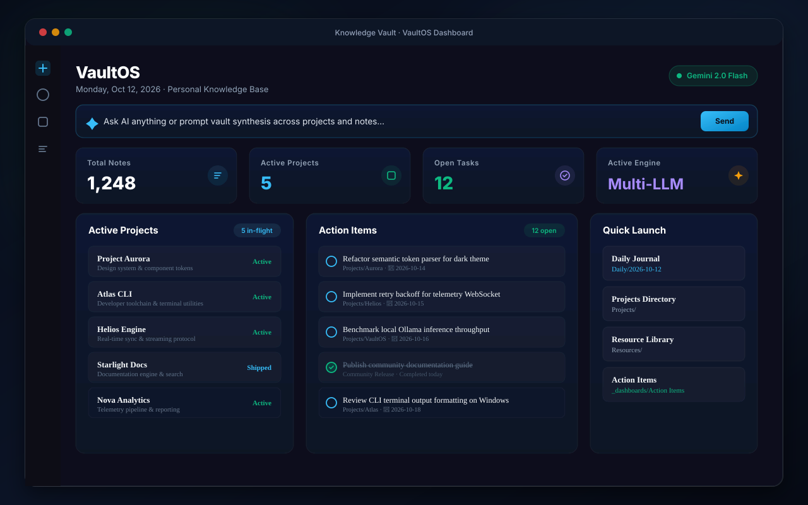

# VaultOS

A customizable bento dashboard, workspace telemetry, and multi-model AI assistant for Obsidian.

[](https://obsidian.md)
[](https://opensource.org/licenses/MIT)

VaultOS adds a dashboard homepage to your vault. It displays your notes, active projects, open tasks, and quick navigation in a clean bento layout, with an integrated AI assistant supporting Gemini, Claude, OpenAI, and local Ollama models.



---

## Features

- **Bento Dashboard**: Overview of total notes, active workstreams, open action items, and model status.
- **Multi-Model AI Assistant**:
  - **Google Gemini** (1.5 Flash, 1.5 Pro, 2.0)
  - **Anthropic Claude** (3.5 Sonnet, 3.5 Haiku, 3 Opus)
  - **OpenAI** (GPT-4o, GPT-4o-mini, o1-mini)
  - **Ollama** (Local models: Llama 3, Mistral, Qwen)
- **Theme Support**: Uses Obsidian's native CSS variables to match both light and dark themes without styling conflicts.
- **Interactive Tasks**: Mark tasks complete directly from the dashboard to update the source note.
- **Quick Links**: Pinned shortcuts to open frequently used project pages and daily notes.

---

## Installation

### Community Plugins
1. Open **Settings** → **Community plugins**.
2. Turn off **Restricted mode**.
3. Search for **VaultOS**.
4. Select **Install**, then **Enable**.

### Manual Installation
1. Download `manifest.json`, `main.js`, and `styles.css` from the latest [Release](https://github.com/Rbm3267/obsidian-vaultos/releases).
2. Create a folder named `vaultos` inside `.obsidian/plugins/` in your vault.
3. Move the downloaded files into `.obsidian/plugins/vaultos/`.
4. Reload Obsidian and turn on **VaultOS** under **Community plugins**.

---

## Configuration

In **Settings** → **VaultOS**:
- Choose your default AI provider.
- Enter your API key or local Ollama address.
- Set your preferred project folder and startup options.

---

## Development

```bash
git clone https://github.com/Rbm3267/obsidian-vaultos.git
cd obsidian-vaultos
npm install
npm run dev    # watch build
npm run build  # production build
```

---

## License

MIT License © 2026 [XD Labs](https://xdlabs.io) / Bennett Moore.
